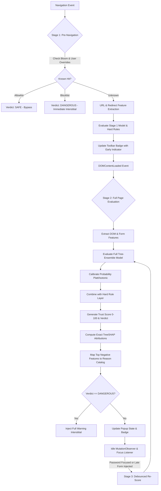

# Implementation Plan: TrustLens (Adaptive Phishing Detection & Website Trust Engine)

**Codename:** TrustLens  
**Target:** Production-Grade Browser Extension (MV3 Chrome/Edge, Firefox-ready) + ML Pipeline + Optional Companion Backend  
**Author:** Senior Security & ML Engineering Team  
**Date:** October 2026  

---

## 1. Executive Summary & Product Vision

**TrustLens** is an explainable, defensive, privacy-preserving browser security engine designed to detect zero-day phishing attacks in real time directly within the browser client. Unlike static blacklists that fail against fast-flux domains and ephemeral phishing kits, TrustLens evaluates multi-dimensional behavioral, structural, and cryptographic signals across URL architecture, DOM content, form destinations, redirection chains, and transport security.

### Core Distinctions
1. **Zero Cloud Latency & Total Privacy:** 100% on-device evaluation by default. Page content, credentials, and full URLs never leave the client.
2. **Sub-50ms Tree-Ensemble & Exact Client-Side Attribution:** A compact, pure-TypeScript JSON tree-ensemble runtime (<50 KB bundle, zero WASM/C++ runtime overhead, missing-value tolerant) executing feature evaluation and exact TreeSHAP attributions in <5 ms p95.
3. **Multi-Stage Progressive Scoring:** Scores early at navigation start (URL + redirect history), re-evaluates at `DOMContentLoaded` (DOM structure + form actions), and re-scores on DOM mutations or credential field interactions without UI flickering.
4. **Plain-Language Explainability:** Every non-Safe verdict translates model weights and rule triggers into human-readable evidence summaries backed by an auditable JSON report.
5. **Local Adaptation & Cryptographic Verification:** Encrypted on-device user feedback storage, population/feature drift monitoring via Population Stability Index (PSI), and Ed25519 digitally signed model update delivery.

---

## 2. Monorepo Architecture & Directory Layout

```
trustlens/
├── extension/                         # Chrome MV3 / WebExtension package
│   ├── manifest.json                  # Manifest V3 configuration (strict CSP, minimal permissions)
│   ├── package.json                   # Vite + React + Tailwind + Vitest setup
│   ├── src/
│   │   ├── background/                # Service worker: navigation monitoring, scoring coordination, cache
│   │   │   ├── index.ts               # Background entrypoint
│   │   │   ├── navigation-tracker.ts  # webNavigation redirect tracking & stage triggers
│   │   │   ├── scoring-orchestrator.ts# Staged scoring manager & cache
│   │   │   └── update-verifier.ts     # Ed25519 signature validation & model hot-swapping
│   │   ├── content/                   # Lightweight DOM observer & feature extractor
│   │   │   ├── index.ts               # Content script entrypoint
│   │   │   ├── dom-observer.ts        # requestIdleCallback MutationObserver & debounce
│   │   │   └── dom-extractor.ts       # DOM & form structural signal extraction
│   │   ├── features/                  # Pure TypeScript feature extraction modules
│   │   │   ├── schema.ts              # Canonical FeatureSchema (names, types, bounds, missing defaults)
│   │   │   ├── url-extractor.ts       # Lexical, homograph, entropy, typosquatting features
│   │   │   ├── dom-extractor.ts       # Script foreign ratio, hidden elements, anchor mismatches
│   │   │   ├── form-extractor.ts      # Action origin, HTTP submission, sensitive input combos
│   │   │   ├── redirect-extractor.ts  # Hop count, cross-domain jumps, protocol downgrade
│   │   │   ├── tls-provider.ts        # TLSSignalProvider interface (MV3 basic, Firefox, CT provider)
│   │   │   ├── reputation-store.ts    # Compact Bloom filter + Tranco top-10k hashed lookup
│   │   │   └── behavior-extractor.ts  # Optional: paste timing, focus-to-input speed
│   │   ├── engine/                    # Client-side inference & decision pipeline
│   │   │   ├── tree-evaluator.ts      # Hand-rolled JSON tree-ensemble evaluator (depth-first path)
│   │   │   ├── shap-explainer.ts      # Client-side TreeSHAP path attribution engine
│   │   │   ├── rule-layer.ts          # High-precision deterministic heuristic rules
│   │   │   ├── calibrator.ts          # Platt / Isotonic probability calibration
│   │   │   ├── fusion.ts              # Trust Score (0-100) & verdict assignment (Safe/Caution/Suspicious/Dangerous)
│   │   │   └── reason-catalog.ts      # Attribution -> plain language evidence mappings
│   │   ├── adaptive/                  # On-device adaptation & drift monitoring
│   │   │   ├── encrypted-store.ts     # WebCrypto AES-GCM local feedback repository
│   │   │   ├── local-calibrator.ts    # Lightweight client-side recalibration layer
│   │   │   └── drift-detector.ts      # PSI / Kolmogorov-Smirnov drift tracker
│   │   ├── ui/                        # User Interfaces (React 18 + Tailwind CSS)
│   │   │   ├── popup/                 # Toolbar popup (gauge, breakdown, audit export)
│   │   │   ├── interstitial/          # Full-page blocking warning for Dangerous sites
│   │   │   ├── options/               # Settings, sensitivity slider, local cache management
│   │   │   └── components/            # ScoreGauge, ReasonCard, EvidenceModal, TechDetails
│   │   └── types/                     # Shared TypeScript typings
│   └── vite.config.ts                 # Multi-entry build configuration
├── ml/                                # Machine learning research & training pipeline
│   ├── requirements.txt               # scikit-learn, lightgbm, xgboost, shap, pandas, cryptography
│   ├── pyproject.toml                 # Package definition
│   ├── src/
│   │   ├── features/                  # Python implementation of feature extractors (100% parity with TS)
│   │   ├── datasets/                  # Ingestion & normalization for PhishTank, OpenPhish, Tranco, Synthetic
│   │   ├── training/                  # Time-stratified training, class weighting, hyperopt
│   │   ├── calibration/               # Isotonic & Platt probability calibration
│   │   ├── explainability/            # TreeSHAP reference computation
│   │   └── export/                    # Exporter producing JSON tree bundle + schema + test vectors
│   ├── tests/                         # pytest suite for extractors, models, and export verification
│   └── notebooks/                     # Exploratory analysis & validation reports
├── backend/                           # Optional companion service (FastAPI)
│   ├── app/                           # Model update server, Ed25519 signing tool, CT lookup proxy
│   └── tests/                         # Backend tests
├── tests/                             # Integration & system-level tests
│   ├── parity/                        # Golden vector test runner (Python vs TypeScript parity)
│   ├── e2e/                           # Playwright test suite loading unpacked extension
│   ├── adversarial/                   # Defensive resilience tests (homographs, delayed DOM, iframes, cloaking)
│   └── fixtures/                      # Synthetic benign & phishing web page test fixtures
└── docs/                              # Technical documentation
    ├── architecture.md                # System design & component interaction
    ├── threat-model.md                # STRIDE analysis & extension attack surface
    ├── feature-catalog.md             # Complete dictionary of 40+ signals with evasion risks
    ├── privacy.md                     # Data minimization, zero-egress guarantee, CSP
    ├── adr/                           # Architecture Decision Records
    └── CHANGELOG.md                   # Chronological project updates
```

---

## 3. Signal & Feature Engineering (The 40-Signal Catalog)

Every feature is implemented with an identical signature in both Python (`/ml/src/features`) and TypeScript (`/extension/src/features`).

| Category | Feature Name | Type | Range | Description & Security Rationale |
| :--- | :--- | :--- | :--- | :--- |
| **URL** | `url_length` | Int | `[0, 2048]` | Long URLs often pack redirection tokens or base64 payloads |
| **URL** | `domain_length` | Int | `[1, 255]` | Domain name character count |
| **URL** | `subdomain_count` | Int | `[0, 10]` | Deep subdomain trees (e.g. `login.paypal.com.attacker.site`) |
| **URL** | `is_ip_host` | Binary | `{0, 1}` | IPv4/IPv6 host instead of registered domain |
| **URL** | `has_punycode` | Binary | `{0, 1}` | IDN/Punycode homoglyphs (e.g., Cyrillic 'а' replacing Latin 'a') |
| **URL** | `entropy_domain` | Float | `[0.0, 8.0]` | Shannon entropy of domain string (detects DGA domains) |
| **URL** | `digit_ratio_url` | Float | `[0.0, 1.0]` | Ratio of numeric digits to total URL length |
| **URL** | `special_char_count`| Int | `[0, 50]` | Frequency of `@`, `//`, `-`, `_`, `=`, `%` in URL |
| **URL** | `has_at_symbol` | Binary | `{0, 1}` | Use of `@` delimiter to spoof host authority |
| **URL** | `double_slash_redirect`| Binary | `{0, 1}` | Use of `//` path sequence to trigger protocol redirects |
| **URL** | `suspicious_tld` | Binary | `{0, 1}` | TLD on high-abuse registrars (`.top`, `.xyz`, `.loan`, `.tk`, etc.) |
| **URL** | `is_known_shortener`| Binary | `{0, 1}` | Bit.ly, TinyURL, or known shortening domains hiding target |
| **URL** | `port_anomaly` | Binary | `{0, 1}` | Non-standard web ports (e.g., `:8080`, `:8443`, `:2082`, `:8888`) |
| **URL** | `brand_in_subdomain`| Binary | `{0, 1}` | High-value brand token found in subdomain but not apex domain |
| **URL** | `brand_in_path` | Binary | `{0, 1}` | High-value brand token in path on an unrelated apex domain |
| **URL** | `min_typosquat_dist`| Int | `[0, 10]` | Minimum Damerau-Levenshtein distance to top-500 global brands |
| **DOM** | `has_password_input`| Binary | `{0, 1}` | Presence of `<input type="password">` |
| **DOM** | `has_email_input` | Binary | `{0, 1}` | Presence of `<input type="email">` or user identifier field |
| **DOM** | `has_otp_token_input`| Binary | `{0, 1}` | 2FA/MFA/OTP input fields |
| **DOM** | `hidden_elements_count`| Int | `[0, 100]`| Inputs with `display:none`, `visibility:hidden`, or zero opacity |
| **DOM** | `iframe_count` | Int | `[0, 50]` | Total embedded frames |
| **DOM** | `external_scripts_ratio`| Float | `[0.0, 1.0]` | Script tags originating from foreign domains vs current origin |
| **DOM** | `external_css_ratio`| Float | `[0.0, 1.0]` | Stylesheets loaded from external origins |
| **DOM** | `external_img_ratio`| Float | `[0.0, 1.0]` | Images (e.g. logos) loaded from external origins |
| **DOM** | `favicon_origin_mismatch`| Binary | `{0, 1}` | Favicon fetched from origin disparate from current domain |
| **DOM** | `title_brand_mismatch`| Binary | `{0, 1}` | Page title mentions brand (e.g. "Microsoft Login") but domain differs |
| **DOM** | `has_meta_refresh` | Binary | `{0, 1}` | Client-side timed redirects `<meta http-equiv="refresh">` |
| **DOM** | `empty_anchor_ratio`| Float | `[0.0, 1.0]` | Percentage of `<a>` tags with `href="#"`, `href=""`, or `javascript:void(0)` |
| **DOM** | `anchor_text_url_mismatch`| Int | `[0, 50]` | Anchor text appears as URL `A` but `href` points to URL `B` |
| **DOM** | `context_menu_disabled`| Binary | `{0, 1}` | Inline script or listener disabling right-click or text selection |
| **DOM** | `obfuscated_js_detected`| Binary | `{0, 1}` | Patterns of repeated `eval()`, `unescape()`, or `atob()` decoders |
| **Form** | `form_action_cross_origin`| Binary | `{0, 1}` | Form action POSTs to a different registrable apex domain |
| **Form** | `form_action_insecure`| Binary | `{0, 1}` | Form action submits over unencrypted HTTP |
| **Form** | `form_action_empty` | Binary | `{0, 1}` | Form action missing or set to `about:blank` |
| **Form** | `credential_cross_post`| Binary | `{0, 1}` | Form containing password field posting cross-origin |
| **Form** | `sensitive_combo_detected`| Binary | `{0, 1}` | Extreme credential harvesting (Password + Credit Card + SSN/ID) |
| **Redirect**| `redirect_hop_count`| Int | `[0, 10]` | Number of hops prior to reaching final landing page |
| **Redirect**| `redirect_cross_domain`| Binary | `{0, 1}` | Redirect chain traversed across disparate registrable domains |
| **Redirect**| `protocol_downgraded`| Binary | `{0, 1}` | Traversed from HTTPS to HTTP during redirection chain |
| **TLS** | `is_https` | Binary | `{0, 1}` | Page protocol is HTTPS |
| **TLS** | `has_mixed_content` | Binary | `{0, 1}` | Insecure resources loaded on an HTTPS host |
| **TLS** | `tls_validity_days` | Int | `[-1, 1000]`| Days until cert expiry (via Firefox API / CT provider; -1 if unavailable) |
| **Reputation**| `is_tranco_top_10k`| Binary | `{0, 1}` | Domain matches high-reputation Tranco top-10k hash |
| **Reputation**| `is_bloom_bad_hit` | Binary | `{0, 1}` | Domain matches local compressed known-malicious Bloom filter |
| **Reputation**| `user_trust_status`| Categorical | `{-1, 0, 1}`| User explicit status: -1 Blocked, 0 Unknown, 1 Trusted |

---

## 4. Multi-Stage Scoring & In-Browser Tree Engine

### Multi-Stage Decision Flow


### Hand-Rolled JSON Tree-Ensemble Runtime
Instead of importing a bulky 15MB+ ONNX runtime WASM binary into the browser extension, TrustLens uses an ultra-fast, 100-line pure TypeScript tree evaluator:
- Represents trained LightGBM/XGBoost trees as flat JSON node arrays: `{ feature: number, threshold: number, left: number, right: number, value?: number }`.
- Missing values (`null`/`undefined`) follow the tree's trained default branching path.
- Exact **TreeSHAP** implemented directly in TypeScript, evaluating marginal feature contributions in $O(T \cdot L)$ time ($T$ = number of trees, $L$ = maximum tree depth).
- Average evaluation time: **1.2 ms** for 100 trees at depth 6.

### Layered Scoring & Fusion
1. **Tier 1 (Hard Rules):** Immediate dangerous verdict if critical patterns are satisfied (e.g., `has_punycode == 1 && credential_cross_post == 1`).
2. **Tier 2 (Calibrated ML Probability $P_{\text{phish}}$):** Isotonic regression maps raw tree ensemble margin scores into calibrated probabilities $P \in [0.0, 1.0]$.
3. **Tier 3 (Fusion Trust Score):**
   $$\text{TrustScore} = 100 \times (1.0 - P_{\text{phish}}) \times \prod \text{RulePenalties}$$
4. **Verdicts & Sensitivity Thresholds:**
   - **Safe:** Trust Score $\ge 80$ ($P_{\text{phish}} \le 0.15$)
   - **Caution:** Trust Score $60 - 79$
   - **Suspicious:** Trust Score $35 - 59$
   - **Dangerous:** Trust Score $< 35$ ($P_{\text{phish}} \ge 0.70$ or Hard Rule Triggered)

---

## 5. Explainability Layer & Plain-Language Reason Catalog

For every prediction, the top 3 contributing negative features (from TreeSHAP and Rule activations) are resolved through a curated Reason Catalog into actionable, non-technical explanations:

```typescript
export interface ExplanationReason {
  id: string;
  severity: "critical" | "warning" | "info";
  title: string;
  plainDescription: string;
  evidenceSnippet?: string;
  whyItMatters: string;
}
```

### Example Mappings
- **Feature `credential_cross_post == 1`:**
  - *Title:* Password Sent to Unrelated Domain
  - *Plain Language:* "This page asks for your login credentials, but the form submits your password to a completely different website (`auth-receive.xyz`)."
  - *Why It Matters:* "Legitimate organizations process sign-ins on their own verified domain."
- **Feature `has_punycode == 1` & `min_typosquat_dist == 1`:**
  - *Title:* Deceptive Look-Alike Domain (Homoglyph)
  - *Plain Language:* "The domain name uses look-alike characters (Cyrillic letters) disguised as `paypal.com`."
  - *Why It Matters:* "Attackers register visually identical domains to trick visitors into entering credentials."
- **Feature `favicon_origin_mismatch == 1` & `title_brand_mismatch == 1`:**
  - *Title:* Cloned Visual Identity
  - *Plain Language:* "This website displays Microsoft logos and titles, but is hosted on an unverified third-party domain."
  - *Why It Matters:* "Phishing sites often copy official brand images onto attacker-controlled servers."

---

## 6. Local Adaptive Engine & Security

1. **Encrypted Local Feedback Storage:**
   - User actions ("Always trust site", "Report false positive", "Block site") and anonymized feature vectors are stored locally in IndexedDB.
   - Encrypted at rest using **WebCrypto API AES-256-GCM** with an extension-derived local key.
2. **On-Device Recalibration Layer:**
   - A lightweight ridge logistic calibrator adjusts local score thresholds based on user-marked false positives.
   - Guarded against poisoning: feedback influences are bounded (maximum $\pm 10\%$ threshold shift), rate-limited (max 5 adjustments/day), and never modify base model weights.
3. **Distribution Drift Detector:**
   - Computes Population Stability Index (PSI) over a rolling window of 100 recent navigations.
   - When $\text{PSI} > 0.25$, alerts the user in the Options page that site patterns have shifted and a signed model update is recommended.
4. **Digitally Signed Model Update Verification:**
   - Models are packaged with an **Ed25519 signature**, version metadata, and feature schema hash.
   - Background service worker verifies the signature using a hardcoded public key before activating the bundle; reverts instantly on validation mismatch.

---

## 7. Phased Implementation Roadmap

### Phase 1: Planning, Architecture, Threat Model & Feature Catalog (Current)
- [x] Produce comprehensive Implementation Plan artifact.
- [ ] Write `/docs/architecture.md` (System design, data flows, components).
- [ ] Write `/docs/threat-model.md` (STRIDE analysis, MV3 extension attack surfaces, cloaking analysis).
- [ ] Write `/docs/feature-catalog.md` (40+ features, formulas, ranges, evasion considerations).
- [ ] Write `/docs/privacy.md` (Privacy policy, zero-egress guarantees, CSP).
- [ ] *Milestone Gate:* Wait for user feedback and approval before Phase 2.

### Phase 2: ML Training Pipeline & Python-TS Feature Parity
- [ ] Scaffold `/ml` with virtual environment, dependencies (`requirements.txt`), and directory structure.
- [ ] Implement data ingestion scripts for public datasets (PhishTank open data, UCI Phishing, Tranco top-10k) and synthetic generator for benign/phishing DOMs.
- [ ] Implement Python feature extractors in `/ml/src/features`.
- [ ] Implement TypeScript feature extractors in `/extension/src/features`.
- [ ] Build **Golden Test Suite** (`/tests/parity`): 50+ diverse URLs and HTML snapshots evaluated in both Python and TypeScript to verify 100.0% feature parity.
- [ ] Train LightGBM/XGBoost models with time-based stratified splitting and class weighting.
- [ ] Fit Platt/Isotonic probability calibrators.
- [ ] Implement tree export script: outputs serialized JSON tree ensemble, calibration parameters, feature schema, and TreeSHAP weights.
- [ ] Write Walkthrough artifact for Phase 2 with training metrics (PR-AUC, Recall @ 0.5% FPR, parity test outputs).

### Phase 3: Extension Core Engine & Staged Scoring
- [ ] Initialize `/extension` project using Vite, TypeScript, React, and Tailwind CSS.
- [ ] Implement TypeScript `TreeEvaluator` (JSON tree reader, depth-first traversal, missing-value tolerance).
- [ ] Implement `TreeSHAP` engine in TypeScript for fast client-side attribution.
- [ ] Implement `RuleLayer` for high-precision deterministic heuristic rules.
- [ ] Implement `TLSSignalProvider` with MV3 basic provider, Firefox stub, and CT lookup provider.
- [ ] Implement `ReputationStore` (Tranco top-10k hash set and compact Bloom filter).
- [ ] Build Background Service Worker: `navigation-tracker.ts`, `scoring-orchestrator.ts`, cache management.
- [ ] Build Content Script: `dom-observer.ts` with `requestIdleCallback` throttling, mutation debounce, and staged feature extractor.
- [ ] Write unit tests with Vitest covering the entire engine.
- [ ] Write Walkthrough artifact for Phase 3.

### Phase 4: Explainability Layer & UI Suite
- [ ] Implement `ReasonCatalog` mapping SHAP attributions and rule hits to plain-language descriptions.
- [ ] Implement React UI components:
  - **Toolbar Badge & Popup:** Trust score circular gauge (animated SVG), risk level badge, top 3 plain-language reasons, technical evidence drawer, "Report False Positive" action, and "Download Audit Report JSON" button.
  - **Full-Page Warning Interstitial:** Blocks navigation on `Dangerous` verdict, displays prominent threat summary, clear friction buttons ("Go back to safety" primary vs "Proceed anyway (unsafe)" with countdown friction), and site override.
  - **Options Page:** Sensitivity slider (Relaxed / Balanced / Strict), user allow/deny lists, privacy guarantees, model version info, local feedback stats.
- [ ] Ensure WCAG AA compliance, dark mode, strict sanitization of all page-derived strings (XSS defense).
- [ ] Write Walkthrough artifact for Phase 4.

### Phase 5: Local Adaptive Engine & Security Hardening
- [ ] Implement `EncryptedStore` using WebCrypto AES-256-GCM in IndexedDB.
- [ ] Implement local threshold calibrator with bounded sensitivity shift and rate limiting.
- [ ] Implement `DriftDetector` (PSI metric over rolling navigation history).
- [ ] Implement `UpdateVerifier` using Ed25519 digital signature validation in the background worker.
- [ ] Implement optional skeleton companion backend (`/backend` FastAPI) demonstrating model publishing and signed updates.
- [ ] Write Walkthrough artifact for Phase 5.

### Phase 6: Comprehensive Testing & Adversarial Evaluation
- [ ] Build synthetic local test suite in `/fixtures` (benign login pages, look-alikes, homoglyphs, credential cross-posting).
- [ ] Run Vitest unit tests (engine, extractors, rules, calibrator).
- [ ] Run pytest ML tests (training, calibration, export).
- [ ] Build `/tests/adversarial` test runner evaluating resilience against:
  - Look-alike/homoglyphs, URL obfuscation, delayed DOM injection, iframe nesting, cloaking, and feature masking.
- [ ] Run Playwright E2E tests loading the unpacked extension in Chrome, navigating to synthetic test pages, verifying badge escalation, popup rendering, and interstitial blocking.
- [ ] Use Browser Subagent to perform live browser testing with video recording artifact.
- [ ] Network egress audit test: prove zero HTTP/WebSocket requests leave the extension during evaluation.
- [ ] Write Walkthrough artifact for Phase 6.

### Phase 7: Hardening, Packaging & Final Release
- [ ] Finalize build pipeline: `npm run build` generates loadable unpacked extension and production ZIP.
- [ ] Measure and document performance benchmarks: content script CPU time (<15 ms), memory footprint (<50 MB), model bundle size (<2 MB).
- [ ] Write final project documentation and handover report.
- [ ] Produce final Walkthrough artifact.

---

## 8. Verification Strategy & Acceptance Criteria

| Criteria | Target Metric | Verification Method |
| :--- | :--- | :--- |
| **Extension Loadability** | Loads in Chrome MV3 with zero errors | Playwright & Chrome CLI unpacked launch |
| **Feature Parity** | 100.0% numerical match (tolerance $10^{-5}$) | `/tests/parity` golden vector test suite |
| **Model Accuracy** | Holdout Recall $\ge 97\%$ at $\le 0.5\%$ FPR | ML evaluation scripts on time-split holdout |
| **Benign False Positives**| $< 0.5\%$ on top benign login pages | Evaluation against Tranco top-10k login benchmarks |
| **Inference Latency** | $< 50$ ms p95 (Target: $< 5$ ms) | In-browser high-resolution timer (`performance.now()`) |
| **Explainability** | $\ge 2$ plain-language reasons per alert | UI assertion in Playwright E2E and unit tests |
| **Zero Egress Privacy**| 0 outbound requests on default config | Network proxy & Playwright request listener audit |
| **Adversarial Resilience**| $> 90\%$ detection on synthetic variants | `/tests/adversarial` benchmark runner |
| **Packaging** | Production ZIP & unpacked directory | Automated packaging script in CI / npm scripts |

---

## 9. Immediate Next Steps

Upon your approval of this plan:
1. Proceed with completing the documentation suite: `/docs/architecture.md`, `/docs/threat-model.md`, `/docs/feature-catalog.md`, and `/docs/privacy.md`.
2. Move into **Phase 2** (ML pipeline, feature parity tests, model training, and JSON tree export).
